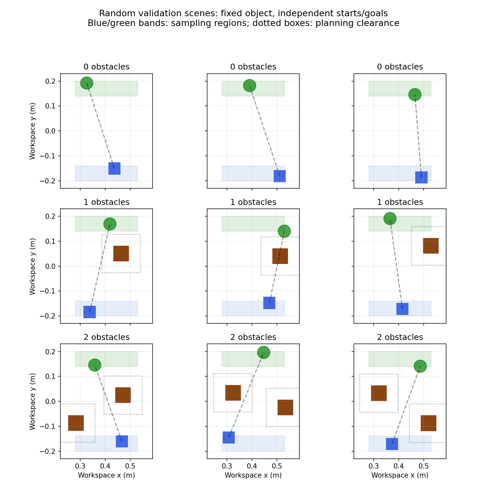

# Random scenes with zero, one or two obstacles

This extension preserves the original frozen single-notebook experiment. It
creates new simulated tasks; the previously reported 5/5 result does not apply
to these tasks. Observations are simulator states, not visual detections.

## Scene distribution

Coordinates are metres. Each episode independently samples:

| Component | x range | y range | Fixed geometry |
|---|---|---|---|
| Object start | 0.28–0.53 | -0.20–-0.14 | 46 × 46 × 50 mm box proxy |
| Goal centre | 0.28–0.53 | 0.14–0.20 | 25 mm success radius |
| Obstacle centres | 0.27–0.54 | -0.09–0.09 | 60 mm cubes, 0–2 per scene |

Object proxy mass, inertia and friction remain fixed, with the same contact
controller as before. Initial/final positions must lie outside conservatively
expanded obstacles, and a visibility graph must admit a path for the object
centre. Two cube centres must be at least 165 mm apart. This rejection sampling
filters geometrically blocked scenes; it is not a proof of physical reachability
or whole-arm collision safety. Starts currently lie below goals, so these results
cannot establish arbitrary pushing-direction generalization.

## Observations and methods

The 20-dimensional observation includes object position, goal-relative position,
tool-relative position, object velocity, two obstacle slots (relative position,
half-size, presence mask), and an optional assistance direction. Slots are sorted
by coordinates; absent obstacles have zero observations and disabled collision
geometry. Both physical obstacles are included in collision penalties.

- `none`: pure RL controls pushing direction. Assistance entries are zero.
- Straight baseline: unit direction to the goal in the `none` environment.
- `planner`: an explicit inflated-obstacle visibility graph supplies direction.
  With zero residual action, this is a geometric planning baseline.
- `demo`: the planner direction is blended with 15% local direction from the
  training-only human-video guide while blocked. This is a heuristic transfer,
  not demonstrated multi-obstacle learning from human videos.

All methods use the same physical controller, success definition and reward.
The initial RL pilot uses the original reward weights without retuning: distance
progress, stable success, contact/escape penalties, time and action smoothness.
Euclidean distance shaping can discourage necessary detours.

## Run

```powershell
.\.venv\Scripts\python.exe scripts\check_random_env.py
.\.venv\Scripts\python.exe scripts\train_random.py --seed 21 --assistance none --stage-steps 1024
```

Curriculum stages sample counts `[0]`, `[0,1]`, then `[0,1,2]`, with 1024 PPO
macro-actions each by default. The model keeps learning across stages. Source
snapshots, hashes, checkpoints and episode results are saved under
`outputs/random_scene/none/21`. Existing run directories cannot be overwritten.

Nine fixed validation scenes (three per obstacle count) use seeds separate from
training. Their scenes are saved before any training. They are development
validation cases, not final tests, and must not be promoted to tests after tuning.
Future final tests need new seeds/layouts and counterfactual obstacle movements
with unchanged starts and goals. A short single-seed pilot is not proof that RL
has converged or independently learned obstacle avoidance.

Having two cubes does not necessarily require two detours: some sampled layouts
leave a direct corridor. Metrics must therefore distinguish obstacle count from
actual route difficulty. The nine-scene pilot includes both obstructed and clear
corridors. Further evaluation should explicitly require two direction changes.
The existing single-obstacle world model is not applied to these new tasks.

## Initial pilot results (seed 21, 3072 PPO steps)

Each column has only three development validation scenes. Success counts:

| Method | 0 obstacles | 1 obstacle | 2 obstacles |
|---|---:|---:|---:|
| Straight to goal | 3/3 | 2/3 | 2/3 |
| Geometric planner | 3/3 | 2/3 | 2/3 |
| Planner with human direction blend | 3/3 | 1/3 | 3/3 |
| Pure PPO, no direction assistance | 2/3 | 0/3 | 0/3 |

Pure PPO did not learn reliable obstacle avoidance in this short run. The human
blend changes which scenes succeed but does not improve overall success over
the two baselines (all reach 7/9). The planner is not a guaranteed executable
contact plan, and its guide can stall or collide. These results justify more
training and controller analysis, not claims of learned multi-obstacle avoidance.



[Two-obstacle human-assisted planning preview](outputs/random_scene/none/21/previews/demo/validation.mp4)
shows validation scene 8, with 28 macro-actions and 17.65 mm final error.
It is an assisted planning baseline, not the trained PPO policy.

Next experiments should inspect failures, use longer training with independent
seeds, and compare matched assisted training before collecting additional human
data. Keep these validation cases separate from new final evaluation layouts.

Optional plotting requires matplotlib:

```powershell
.\.venv\Scripts\python.exe -m pip install matplotlib
.\.venv\Scripts\python.exe scripts\plot_random_scenes.py outputs\random_scene\none\21
```
