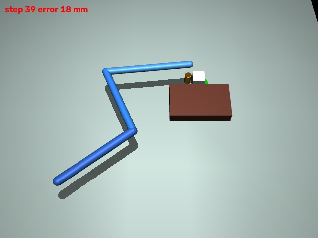
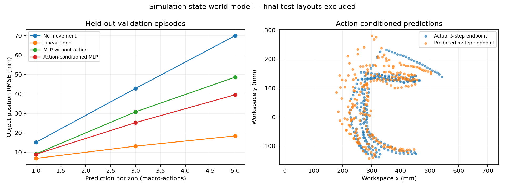

# Human demonstrations to robot pushing

Status: twenty applicant-recorded videos, calibrated trajectory extraction,
physical pushing, state-based PPO and trained state world models are implemented.
Five reserved layouts have been evaluated after freezing the controller and
PPO checkpoint. No VLA or generative-video model is implemented.

Research question: can object-relative motion extracted from personally recorded human pushing videos transfer to a simulated robot, and generalise to changed start/goal/obstacle positions?

Minimum deliverable: recorded videos -> calibrated tabletop trajectories -> robot end-effector commands -> physical manipulation in simulation -> reproducible evaluation.

## Quick start with the submission bundle

Python 3.11 on Windows was used. No GPU is required for the supplied small models.
The submission bundle includes prepared applicant trajectories, trained checkpoints,
frozen reports and example media. Original recordings are needed only to rerun
video extraction; see [DATA_CARD.md](DATA_CARD.md).

```powershell
python -m venv .venv
.\.venv\Scripts\python.exe -m pip install -r requirements.txt
.\.venv\Scripts\python.exe scripts\verify_bundle.py
.\.venv\Scripts\python.exe scripts\preview_rl.py outputs\rl\residual\9\policy.zip --demo-index 0 --output outputs\review_preview
```

`verify_bundle.py` checks packaged file hashes, train/validation/test separation,
environment behavior, checkpoint inference and the saved linear world model's
one-step metric. It does not rerun or tune final test policies. The preview uses
a validation layout and samples macro-actions at 3 fps, not real-time motion.

Example applicant data tracking:

<video src="outputs/dataset/4adc8157380f6541c351f3929c693d36/tracking.mp4" controls width="300"></video>

[Tracking video](outputs/dataset/4adc8157380f6541c351f3929c693d36/tracking.mp4)
and [robot preview](outputs/rl_preview_v3/validation_policy.mp4) are included.




The source scripts below describe full reproduction. Existing checkpoint runs are
protected against overwrite: train PPO with a new seed (for example 10) for a
new experiment. Final-test results are already frozen and must not guide tuning.

The approach uses geometric calibration and a training-video nearest-neighbour
direction guide, a fixed contact controller, a small PPO residual, and a separate
action-conditioned state predictor. It deliberately fits small compute budgets.

## Milestones

- 11 October: isolate environment, run robot simulation, establish extraction interface.
- 12 October: validate one real video, then collect the full dataset and transfer one trajectory.
- 13 October: run baselines and an object-relative retargeting method; add learning if feasible.
- 14 October: evaluate held-out configurations, inspect failures, run ablations.
- 15 October: record paired human/robot demos and write reproducibility instructions.
- 16 October: clean-environment check and application submission.

## Evaluation protocol

Final comparison uses straight-line control, training-video direction guidance,
goal-weighted guidance, and PPO residual guidance with the same contact controller
and five saved initial scenes. Complete video IDs separate training, validation
and test; adjacent frames are never randomly split. Source hashes and settings
are frozen before testing. Earlier replay results remain development checks.

Physical robot evaluation must measure object motion under contact. Moving a rendered marker or teleporting an object is not a robot manipulation result. Human path clearance does not establish robot clearance because the arm and fingers have different geometry.

See [CAPTURE_GUIDE_ZH.md](CAPTURE_GUIDE_ZH.md) before recording.

## Run the current prototype (Windows / Python 3.11)

```powershell
python -m venv .venv
.\.venv\Scripts\python.exe -m pip install -r requirements.txt
.\.venv\Scripts\python.exe scripts\prepare_data.py
.\.venv\Scripts\python.exe scripts\run_pilot.py
```

Put the original 720x1280 videos in `data/`. The extraction script currently
detects the brown notebook quadrilateral and uses scene-specific colour/size
masks. When the notebook matches the reviewed original view, reference-template
translation is preferred to avoid shadow boundaries biasing the colour contour.
That alignment assumes unchanged scale and orientation; corner overlays must
be reviewed for future layouts, particularly rotated notebooks.
The notebook's long side is 22 cm and short side 13 cm. Its thickness and object
height introduce unmeasured parallax: coordinates are approximate.

`outputs/dataset/manifest.json` records source hashes, split, calibration corners and extraction gaps.
`trajectory_prepared.csv` preserves the original validity flag and separately
marks any interpolated samples. Videos, derived coordinates, and model
parameters are labelled by split. `data/splits.json` freezes twelve training and three
validation videos before policy learning. Five new-layout videos are reserved
for testing. New video IDs stay unassigned until registered;
`run_pilot.py` excludes test and unassigned videos. The original five were already
used to develop the controller, so they must not be described as held-out tests.

`scripts/simulate_push.py` uses a custom serial arm with three planar joints and
a vertical tool slide in MuJoCo. It does not use Panda or LIBERO. A free object
moves through simulated contact with a cylindrical tool; the object state is
never assigned after initialisation. Arm-link collisions are disabled due to
the simplified geometry, while tool, obstacle and object collisions remain
active. This means the prototype does not establish whole-arm safety.

The human video determines the waypoint sequence. A geometric inverse
kinematics and feedback controller executes it, lifting the tool when changing
contact sides. No timing transfer or learned policy is claimed. Straight-line
control receives the same start and endpoint, and uses the same controller.

Results in `outputs/evaluation/results.json` measure error to the demonstration
endpoint, contact steps at a 2 ms physics timestep, and endpoint reach within
2.5 cm. This is replay fidelity, not success at an independently annotated goal.
For a preview, add `--render` to a single simulation command; the MP4 is sampled
at 10 fps in simulation time.

## Reinforcement learning pilot

```powershell
.\.venv\Scripts\python.exe scripts\check_rl_env.py
.\.venv\Scripts\python.exe scripts\compare_weights.py
.\.venv\Scripts\python.exe scripts\train_rl.py --steps 2048 --seed 9 --goal-weight 0.85 --residual-weight 0.35
```

The RL environment uses an approximate square object (46 x 46 x 50 mm), with
proxy mass/inertia; actual object dimensions are unmeasured. Macro-actions choose
a pushing direction, while a fixed IK controller lifts, repositions, and pushes.
Arm-link collisions remain disabled. Observations use privileged simulator
state, so this is state-based RL, not VLA training.

A nearest-neighbour imitation guide is built exclusively from training video
object trajectories. PPO learns a bounded residual on its direction. The guide
is a data-driven policy and does not replay the evaluation video's trajectory.
`--scratch` removes the guide from the action computation and replaces its
observation entries with zeros. It still uses the same scene distribution for
a matched comparison. The current arm links are 27, 25 and 30 cm; the earlier
65 cm arm could not reach some necessary behind-object contact positions.
Macro-actions now push for 50 substeps of 20 physics steps each, following tool
repositioning. Old seed-7 results use the earlier arm and shorter pushing phase
and are not comparable as a seed replicate. Each new run saves source snapshots
and hashes next to its checkpoint.

Goals for training/validation are prescribed before each reset using recorded
endpoints, with small training perturbations. They are not recomputed from robot
final states. Final testing uses independently marked goals; test data is
loaded only by `evaluate_final.py`, never by training. The notebook coordinate
frame normalizes its camera rotation/translation; this does not demonstrate
robustness to arbitrary world-frame obstacle rotations.

Reward per macro-step: 40 times decrease in goal distance (metres), +30 on stable
success, -10 on object/tool obstacle contact, -0.05 time cost, -0.01 squared action
change, and -15 on object escape. Collision and escape terminate the episode;
100 macro-steps truncate it. Success requires distance <25 mm and speed <30 mm/s
for two consecutive macro-steps. Distance shaping can discourage initial
detours; reward weights are provisional. Training return alone is not a task
metric. Reports include success, collision, distance, step count, and simulation
time on three validation layouts.

The current controller enumerates analytic planar IK branches, settles the
raised tool before lowering, and stops pushing within 18 mm of the goal. The
goal remains defined independently at reset and success tolerance remains
25 mm. The base direction uses training demonstrations while the obstacle
blocks the object-centre segment to the goal. Once that segment clears an
expanded rectangle, it blends 85% unit goal direction with 15% demonstration
direction; this geometric check is a heuristic, not a whole-arm safety proof.
PPO adds a residual scaled by 0.35. An ablation on the same three validation
layouts compares goal weights 0, 0.5, 0.85, and 1. The obstacle detour always
continues to use applicant data. Geometry/controller changes must be compared
separately from PPO learning; previous checkpoints require their saved sources.

## Small state world model

```powershell
.\.venv\Scripts\python.exe scripts\world_model.py --train-episodes 24 --validation-episodes 6 --epochs 300
```

The model learns an action-conditioned transition of the simulated system's
state (joint/object pose, velocities and servo controls), given task context and
friction. It predicts deltas, including object position. It does not simply set
physics parameters, and does not learn real physical parameters from videos.
Personally recorded videos determine the training-only demonstration guide and
scene distribution; transition targets come from MuJoCo interactions. Random
residual actions provide action variation. The surrogate includes the fixed
macro-action controller as well as physical contact dynamics.

Training and validation use different complete demonstration IDs and episodes.
The five final-test IDs are excluded. A small MLP is compared to persistence, a
linear ridge model, and an action-blind MLP. Evaluation measures object-position
RMSE, median error and 95th-percentile error at 1, 3 and 5 macro-steps. Multi-step
rollouts start from a true initial state and recursively propagate predicted
states using recorded future actions and fixed context; they are not teacher
forced with future true dynamic states. Predicted quaternions are normalised,
but no other physical consistency is imposed. Long-horizon fidelity is therefore
an empirical question, not a guarantee.

Outputs are in `outputs/world_model/`: simulation datasets, checkpoints,
normalization parameters, ridge coefficients, rollout examples and a report.
This model is evaluated for prediction only; it is not yet used to plan actions
or improve PPO. Source: [World Models, Ha and Schmidhuber](https://arxiv.org/abs/1803.10122).

948 simulated transitions from 24 training episodes and 261 transitions from
6 validation episodes produce the following recursively predicted object-position
RMSE. Each step is a controller macro-action, not a video frame.

| Model | 1 step (mm) | 3 steps (mm) | 5 steps (mm) |
|---|---:|---:|---:|
| No-movement prediction | 15.15 | 42.89 | 70.06 |
| Linear ridge | **6.84** | **13.14** | **18.42** |
| MLP without action | 9.16 | 30.84 | 48.69 |
| Action-conditioned MLP | 8.98 | 25.27 | 39.62 |

Action conditioning helps the MLP, especially across multiple steps, but the
linear model is better on this small dataset. A neural model is not automatically
the stronger choice. These are validation results for simulated state prediction,
with a single training seed and no claim of long-horizon physical consistency.

## Frozen final policy evaluation

Run once after preparing the data and training seed 9:

```powershell
.\.venv\Scripts\python.exe scripts\evaluate_final.py
```

The script freezes source/checkpoint hashes before rollout and refuses to overwrite
an existing freeze. Each test uses only its first detected object position and the
independently placed black target marker. Later test-video positions are never
used for action selection. Full results and trajectories are in
`outputs/final_test/report.json`; configuration is in `freeze.json`.

Five scenes are a small demonstration of transfer, not a broad benchmark.
Manual marker locations, planar calibration and proxy object physics limit
accuracy. Only object/tool obstacle contact is measured, not whole-arm safety.

| Frozen method | Success | Obstacle contact | Mean final error (mm) |
|---|---:|---:|---:|
| Straight to goal | 0/5 | 5/5 | 224.67 |
| Training-video guide | 3/5 | 1/5 | 73.11 |
| Goal-weighted guide | **5/5** | **0/5** | 17.82 |
| Goal-weighted guide + PPO | **5/5** | **0/5** | 17.75 |

The plain guide also has one object-escape failure. The weighted guide succeeds
in a mean 29.6 macro-actions versus 31.8 for PPO. PPO provides no meaningful
improvement on these five tests; the successful method combines the applicant's
training demonstrations with goal direction and a hand-designed contact
controller. No controller or policy tuning followed these test results.

What worked: object-relative directions transfer from human videos to a different
simulated embodiment; goal blending improves the small test set; a simple linear
state model beats the neural surrogate. What did not: straight pushing collides,
the unweighted guide can escape, and short PPO training does not beat the weighted
guide. Future work should measure object physics, evaluate full-arm collision,
collect more diverse scenes, and test visual observations with independent goals.
